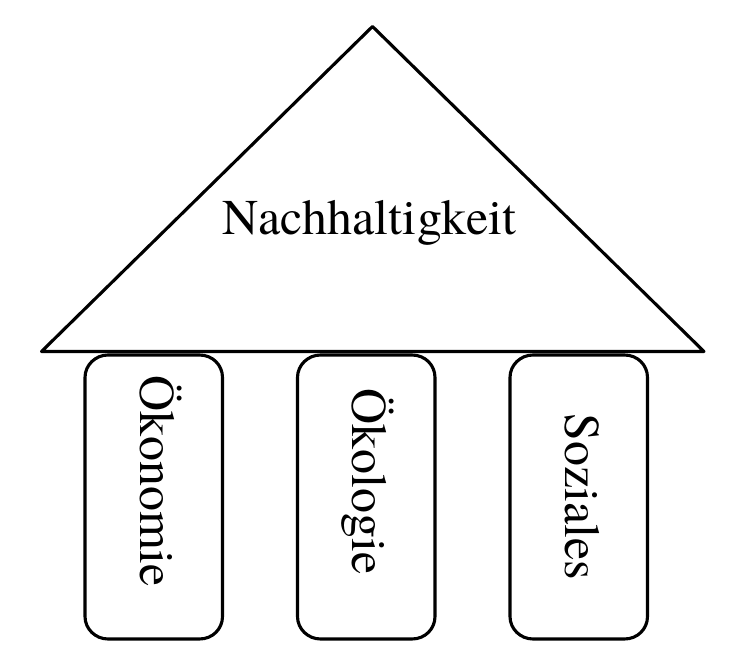

# 5. Kapitelseiten: Eine Vorlage, sechs Mal verwendet

Die sechs Kapitel der Studienarbeit sind sechs HTML-Seiten mit **demselben Grundaufbau**. Wer eine Seite verstanden hat, versteht alle. Dieses Kapitel erklärt zuerst die gemeinsame Vorlage (am Beispiel von `introduction.html`) und danach die Besonderheiten jeder Seite.

Kapitelseiten enthalten **keine Programmlogik**. Sie bestehen aus HTML, Bootstrap-Klassen und je einer CSS-Datei. Das einzige Skript ist `auth-check.js` (Kapitel 4).

---

## Der gemeinsame Aufbau

Jede Kapitelseite hat von oben nach unten dieselben Bausteine:

| Baustein | Beispiel (`introduction.html`) | Erklärt in |
| --- | --- | --- |
| `<head>` mit Bootstrap und eigener CSS-Datei | Z. 4–15 | Kapitel 0 |
| Navigationsleiste, aktueller Punkt markiert | Z. 18–51 | Kapitel 1 |
| **Hero-Banner** mit Kapiteltitel | Z. 55–60 | dieses Kapitel |
| **Inhaltsbereich** in `container`, `row`, `col-lg-9` | Z. 63–150 | dieses Kapitel |
| Fußzeile mit Zurück/Weiter | Z. 154–159 | Kapitel 1 |
| Skripte (Bootstrap und `auth-check.js`) | Z. 162–165 | Kapitel 0 und 4 |

### Der Hero-Banner und der Inhaltsbereich (Z. 53–66)

```html
 53 |     <main role="main">
 54 |         <!-- Chapter Title Hero Banner -->
 55 |         <div class="container-fluid hero d-flex align-items-center justify-content-center text-center text-white">
 56 |             <div class="px-3">
 57 |                 <h1 class="display-4 font-weight-bold">1. Introduction</h1>
 58 |                 <p class="lead">Bridging Economy and Ethics in a Globalized World</p>
 59 |             </div>
 60 |         </div>
 61 |
 62 |         <!-- Chapter Main Content Container -->
 63 |         <div class="container my-5">
 64 |             <div class="row justify-content-center">
 65 |                 <div class="col-lg-9">
 66 |
```

- **Z. 55** Das Banner ist wie auf der Landing Page ein `container-fluid` über die volle Breite, mit Flexbox zentriert und weißem Text. Die Klasse `hero` kommt aus der **seiten-eigenen CSS-Datei**: Jedes Kapitel hat dort einen **eigenen Farbverlauf** (siehe Tabelle unten). So erkennt man die Kapitel an der Farbe.
- **Z. 57** Die einzige `<h1>` der Seite ist der Kapiteltitel. `display-4` ist etwas kleiner als `display-3` auf der Landing Page.
- **Z. 63** Der Inhalt liegt in einem zentrierten `container` mit Abstand oben und unten (`my-5`).
- **Z. 64–65** Eine `row` mit **einer Spalte** (`col-lg-9`): Auf großen Bildschirmen nimmt der Text 9 von 12 Spalten ein und ist durch `justify-content-center` mittig. So bleibt die Zeilenlänge gut lesbar. Auf kleinen Bildschirmen ist die Spalte so breit wie das Fenster.

### Ein Abschnitt (Z. 67–84)

```html
 67 |                     <!-- Background and Motivation Block -->
 68 |                     <section class="mb-5">
 69 |                         <h2 class="font-weight-bold text-dark border-bottom pb-2 mb-4">Background & Motivation</h2>
 70 |                         <p class="lead text-secondary">
 71 |                             At first glance, economics and ethics are often perceived as two separate segments.
 72 |                             However, business ethics brings these fields closer together. A central concept
 73 |                             shaping this integrated discipline is <strong>Corporate Social Responsibility
 74 |                                 (CSR)</strong>.
 75 |                         </p>
```

- **Z. 68** Jeder inhaltliche Block ist ein `<section>` mit Abstand nach unten (`mb-5`). Das gliedert die Seite semantisch.
- **Z. 69** Die Abschnittsüberschrift `<h2>` mit der immer gleichen Kombination: `font-weight-bold text-dark` (fett, dunkel), `border-bottom` (Linie darunter), `pb-2 mb-4` (Abstände). Dieses Muster sorgt für ein einheitliches Aussehen aller Kapitel.
- **Z. 70** `lead text-secondary`: der erste Absatz ist größer und grau.
- **Z. 73** `<strong>` hebt wichtige Begriffe hervor und wird von Screenreadern betont.

### Eine verlinkte Liste (Z. 99–111)

```html
 99 |                     <section class="mb-5">
100 |                         <h2 class="font-weight-bold text-dark border-bottom pb-2 mb-4">Structure of the Thesis</h2>
101 |                         <div class="list-group shadow-sm">
102 |                             <a href="definitions.html"
103 |                                 class="list-group-item list-group-item-action d-flex justify-content-between align-items-center p-3">
104 |                                 <div>
105 |                                     <h5 class="mb-1 font-weight-bold">Chapter 2: Definitions & Historical Context</h5>
106 |                                     <p class="mb-0 text-muted small">Explains the origin of CSR in the USA, historical
107 |                                         milestones, and key definitions like the EU Commission's Green Paper.
108 |                                     </p>
109 |                                 </div>
110 |                                 <span class="badge badge-primary badge-pill">Next Chapter &rarr;</span>
111 |                             </a>
```

- **Z. 101** Eine Bootstrap-`list-group`: Einträge mit Linien dazwischen und einem Schatten.
- **Z. 102–103** Der **ganze Eintrag ist ein Link** (`<a>` mit `list-group-item-action`). `list-group-item-action` färbt ihn beim Darüberfahren. `introduction.css` ergänzt eine kleine Verschiebung (Kapitel 6).
- **Z. 103** `d-flex justify-content-between align-items-center`: Text links, Badge rechts.
- **Z. 110** Ein `badge badge-pill` mit „Next Chapter →“. Die anderen vier Einträge der Liste haben **kein** Badge. Das ist vermutlich nicht beabsichtigt, wirkt aber wie ein Hinweis nur auf den ersten Eintrag.

---

## Die Besonderheiten der Kapitel

Alle Kapitel nutzen dieselben Bootstrap-Bausteine. Die folgende Tabelle zeigt, was jede Seite hervorhebt:

| Kapitel | Hero-Farbverlauf | Besondere Bausteine |
| --- | --- | --- |
| 1. Introduction | `#2c3e50` → `#34495e` (dunkelblau) | `list-group` als Inhaltsverzeichnis |
| 2. Definitions | `#20c997` → `#17a2b8` (türkis) | Karte mit Jahreszahl, Zitatbox, Abbildung 1 mit Erklärliste |
| 3. Facets of CSR | `#6f42c1` → `#4e2a84` (violett) | Karten für Ansätze, Abbildung 2, gestapelte Karten für die Pyramidenstufen, drei Karten, Abbildung 3 |
| 4. Case Studies | `#fd7e14` → `#d9534f` (orange-rot) | Karten mit Badges, verschachtelte Karten, Zitatbox „Takeaway“ |
| 5. Pros & Cons | `#28a745` → `#20c997` (grün) | zwei gleich hohe Spalten mit Pro- und Contra-Listen |
| 6. Perspectives | `#17a2b8` → `#007bff` (blau) | drei Trend-Karten, Fazit, Abschlussbox mit Link |

### Kapitel 2: Zitatbox und Abbildung (`definitions.html`)

```html
112 |                         <div class="card border-left-primary shadow-sm p-4 my-4 bg-light">
113 |                             <blockquote class="blockquote mb-0">
114 |                                 <p class="mb-2 italic">
115 |                                     "[CSR is] a concept whereby companies integrate social and environmental concerns in
116 |                                     their business operations and in their interaction with their stakeholders on a
117 |                                     voluntary basis."
118 |                                 </p>
119 |                                 <footer class="blockquote-footer">
120 |                                     European Commission Green Paper (July 2001) <cite>"Promoting a
121 |                                         European framework for Corporate Social Responsibility"</cite>
122 |                                 </footer>
123 |                             </blockquote>
124 |                         </div>
```

- **Z. 112** Eine Karte mit der **eigenen Klasse** `border-left-primary` aus `definitions.css`: ein dicker blauer Streifen links (Kapitel 6).
- **Z. 113** `<blockquote>` ist das semantische Element für ein **Zitat**.
- **Z. 119–122** `blockquote-footer` ist die Bootstrap-Klasse für die Quellenangabe. `<cite>` bezeichnet den **Titel eines Werks**.
- **Z. 114** Die Klasse `italic` ist **keine Bootstrap-Klasse** und in den eigenen CSS-Dateien nicht definiert. Sie hat deshalb keine Wirkung. Bootstrap 4 nennt die richtige Klasse `font-italic` (siehe Kapitel 7).

```html
139 |                             <div class="col-md-6 text-center mb-4 mb-md-0">
140 |                                 <div class="p-3 bg-white border rounded shadow-sm">
141 |                                     
143 |                                     <small class="d-block text-muted mt-2"><strong>Figure 1:</strong> The
144 |                                         Triple-Bottom-Line Model (Economy, Ecology, Social)</small>
145 |                                 </div>
146 |                             </div>
```

- **Z. 139** `mb-4 mb-md-0` ist ein typisches Bootstrap-Muster: Auf dem Handy steht Abstand **unter** der Spalte (weil sie dort über dem Text liegt), ab mittlerer Breite entfällt er.
- **Z. 141** Die Abbildung. `alt` beschreibt das Bild für Screenreader und wird angezeigt, wenn das Bild nicht lädt. `img-fluid` macht das Bild **flexibel**: Es wird nie breiter als sein Container.
- **Z. 143** `<small class="d-block …">` dient als **Bildunterschrift**. `d-block` macht das Inline-Element zu einem Block, damit es unter dem Bild steht. (Semantisch passender wären `<figure>` und `<figcaption>`.)

### Kapitel 3: Gestapelte Karten (`facets.html`)

```html
117 |                                 <div class="accordion" id="pyramidAccordion">
118 |                                     <div class="card border-0 mb-2 shadow-sm">
119 |                                         <div class="card-header bg-danger text-white py-2" id="headingPhilanthropic">
120 |                                             <h6 class="mb-0 font-weight-bold">1. Philanthropic Responsibilities</h6>
121 |                                         </div>
122 |                                         <div class="card-body p-3">
123 |                                             <p class="small text-muted mb-0">Be a good corporate citizen. Voluntary
124 |                                                 resources contributed to improve quality of life beyond societal
125 |                                                 expectations.</p>
126 |                                         </div>
127 |                                     </div>
```

- **Z. 117** `accordion` ist in Bootstrap der Name für **ausklappbare** Abschnitte. Hier sind die Abschnitte aber **immer geöffnet**: Es gibt kein `collapse` und kein `data-toggle`. Die Klasse dient nur dem Styling (`facets.css` gibt den Kopfzeilen abgerundete Ecken).
- **Z. 119** Jede Stufe der Pyramide hat eine **eigene Farbe** durch Bootstrap-Hintergrundklassen (`bg-danger`, `bg-warning`, `bg-info`, `bg-secondary`). Die Reihenfolge entspricht der Pyramide von oben (philanthropisch) nach unten (ökonomisch).
- **Z. 119** Die `id`s (`headingPhilanthropic` usw.) haben aktuell keine Funktion. Sie wären nötig, wenn man den Bereich ausklappbar machen würde.

### Kapitel 4: Zitatbox mit Takeaway (`case-studies.html`)

```html
154 |                             <blockquote
155 |                                 class="blockquote bg-white p-3 rounded border-left border-danger text-muted mb-0 mt-2 small">
156 |                                 <em>Takeaway: CSR cannot exist merely as a public relations tool. Without genuine
157 |                                     alignment between top-level strategy, executive incentives, and ethical standards,
158 |                                     public credibility can be destroyed instantly.</em>
159 |                             </blockquote>
```

- **Z. 155** Eine Zitatbox **nur mit Bootstrap-Klassen**: `border-left border-danger` ergibt einen roten Streifen links. Im Gegensatz zu Kapitel 2 braucht es hier keine eigene CSS-Klasse.
- **Z. 156** `<em>` bedeutet Betonung und wird kursiv dargestellt.

### Kapitel 5: Zwei gleich hohe Spalten (`pros-cons.html`)

```html
 72 |                     <div class="row">
 73 |                         <!-- Advantages Column -->
 74 |                         <div class="col-lg-6 mb-4">
 75 |                             <div class="card border-success shadow-sm h-100">
 76 |                                 <div class="card-header bg-success text-white">
 77 |                                     <h3 class="h5 font-weight-bold mb-0">Advantages (Opportunities)</h3>
 78 |                                 </div>
 79 |                                 <div class="card-body">
 80 |                                     <ul class="list-unstyled">
 81 |                                         <li class="mb-3 border-bottom pb-2">
 82 |                                             <strong class="text-success">&check; Reputation & Brand Equity:</strong>
 83 |                                             <p class="small text-muted mb-0">Enhances brand image, fostering long-term
 84 |                                                 customer loyalty and trust.</p>
```

- **Z. 74** `col-lg-6`: nebeneinander auf großen Bildschirmen, untereinander auf kleinen. `mb-4` gibt Abstand, wenn die Spalten gestapelt sind.
- **Z. 75** `h-100` (height: 100 %) macht beide Karten **gleich hoch**, auch wenn eine mehr Text hat.
- **Z. 76** Der Kopf der Karte ist grün (`bg-success`). Die Gegenseite ist rot (`bg-danger`, `border-danger`). Das Farbschema macht „Vorteil/Nachteil“ auf einen Blick erkennbar.
- **Z. 77** `<h3 class="h5">`: Die Überschrift ist semantisch eine `<h3>` (richtige Hierarchie unter `<h1>`), sieht aber aus wie eine `<h5>`. Bootstrap trennt so **Struktur** und **Aussehen**.
- **Z. 80** `list-unstyled` entfernt die Aufzählungspunkte.
- **Z. 82** `&check;` ist die HTML-Entity für ein Häkchen (✓).

### Kapitel 6: Abschluss mit Link (`perspectives.html`)

```html
126 |                     <section class="text-center my-5">
127 |                         <div class="p-5 bg-white rounded shadow border">
128 |                             <h3 class="font-weight-bold mb-3">Thank you for exploring this interactive presentation!
129 |                             </h3>
130 |                             <p class="text-muted mb-4">You can revisit the registration form or redownload the complete
131 |                                 PDF research paper anytime.</p>
132 |                             <a href="landing.html" class="btn btn-primary btn-lg font-weight-bold px-4">Back to Landing
133 |                                 Page</a>
134 |                         </div>
135 |                     </section>
```

- **Z. 126–127** Eine zentrierte Abschlussbox (weiß mit Schatten und Rahmen).
- **Z. 130–132** Der Text verspricht das erneute Herunterladen des PDFs. Dafür führt der Button zurück zur Landing Page, wo das Formular das PDF erneut auslöst.

---

## Typische Fragen

**Warum gibt es für jede Seite eine eigene CSS-Datei, obwohl sie fast gleich sind?**
Das ist eine Entscheidung für klare Zuordnung: Jede Seite hat ihren eigenen Farbverlauf und ihre Besonderheiten. Der Nachteil: Die gemeinsamen Regeln (`body`, `.navbar`, `.hero`) sind in jeder Datei wiederholt (Kapitel 6).

**Wie funktioniert das responsive Verhalten ohne eigene Media Queries?**
Das erledigt das Bootstrap-Raster mit seinen Klassen: `col-md-6`, `col-lg-9`, `mb-md-0`. Die Breiten und Umbrüche sind in Bootstrap definiert. Die eigenen CSS-Dateien enthalten nur wenige Media Queries.

**Was ist der Unterschied zwischen `<section>` und `<div>`?**
`<section>` hat eine Bedeutung („inhaltlicher Abschnitt“) und hilft Screenreadern und Suchmaschinen. `<div>` ist rein ein Behälter ohne Bedeutung und wird für Layout und Gestaltung genutzt.

**Warum sind die Überschriften `<h2>`, `<h3>` und gleichzeitig mit Klassen wie `h5` gestaltet?**
Die Überschriftenebene gehört zur Dokumentstruktur, Größe und Aussehen sind Gestaltung. Mit den Klassen `h1` bis `h6` kann man beides unabhängig wählen.

**Was bedeutet `alt` bei Bildern, und warum ist es wichtig?**
Der Alternativtext ersetzt das Bild für Screenreader und wird angezeigt, wenn das Bild nicht geladen werden kann. Er gehört zur Barrierefreiheit.

---

## Mach es selbst

1. Ändere in `introduction.html` die Spaltenbreite `col-lg-9` (Z. 65) in `col-lg-12`. Wie wirkt der Text auf einem großen Bildschirm?
2. Füge in `introduction.html` bei den anderen vier Einträgen der Liste ebenfalls ein Badge hinzu (z. B. „Chapter 3 →“). Sieht die Liste jetzt einheitlicher aus?
3. Ersetze in `definitions.html` die Klasse `italic` (Z. 114) durch `font-italic`. Was ändert sich beim Zitat?
4. Füge in `facets.html` bei einer Pyramidenstufe `data-toggle="collapse"` und `data-target` hinzu, damit sich der Text ausklappen lässt. Welche `id` musst du dafür vergeben, und wie ändert sich die Klasse `collapse` am Text?
5. Ändere in `pros-cons.html` bei einer Karte `h-100` auf nichts. Was passiert mit der Höhe der beiden Karten?
